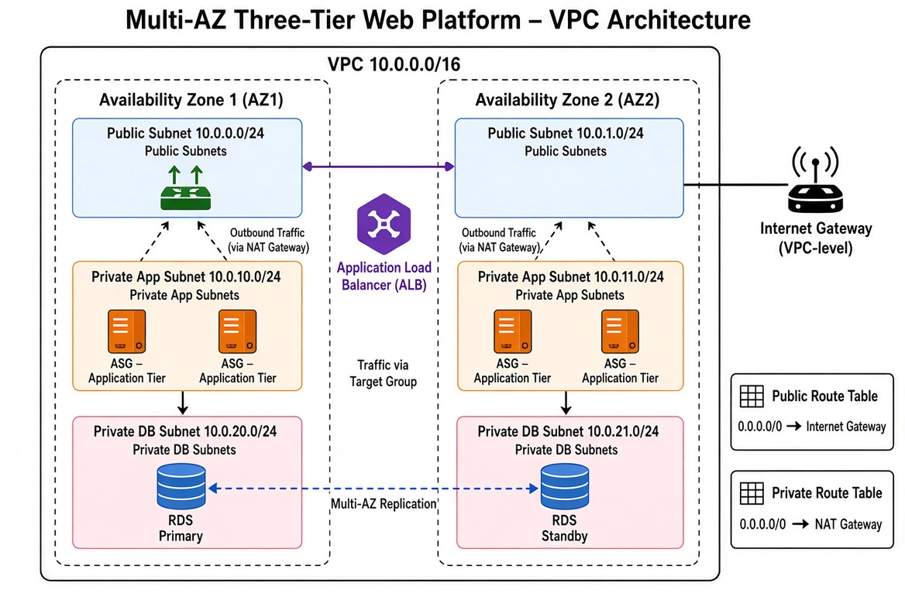

# AWS 3-Tier Web Architecture with Terraform & GitHub Actions

## Overview
This repository contains the Infrastructure as Code (IaC) to provision a production-grade, highly available, and secure three-tier web application environment on AWS. The infrastructure is entirely managed by Terraform and deployed via a GitHub Actions CI/CD pipeline using keyless OIDC authentication.

## Architecture Highlights
* **Network Isolation:** 3-tier Virtual Private Cloud (VPC) spanning two Availability Zones.
* **Zero-Trust Security:** Chained Security Groups enforcing least-privilege access (ALB -> EC2 -> RDS).
* **Automated Scalability:** Auto Scaling Group (ASG) behind an Application Load Balancer (ALB) with dynamic ELB health checks.
* **High Availability Data:** Multi-AZ Amazon RDS PostgreSQL deployment.
* **Enterprise Secrets Management:** Automated cryptographic password generation securely stored in AWS Secrets Manager.
* **Modern State Management:** Remote S3 backend utilizing native conditional writes (`use_lockfile = true`) for state locking.

## Infrastructure Tiers

### 1. Public Tier (Routing & Load Balancing)
* **Application Load Balancer (ALB):** Internet-facing entry point routing HTTP/HTTPS traffic to the private application tier.
* **NAT Gateway:** Provides outbound internet access for private application instances to download patches and external packages.

### 2. Private App Tier (Compute)
* **Auto Scaling Group:** Deploys Amazon Linux 2023 EC2 instances running an Apache web server.
* Instances are dynamically placed into private application subnets and have zero direct inbound internet access.

### 3. Private Data Tier (Database)
* **Amazon RDS for PostgreSQL:** Primary database deployed in a secure DB Subnet Group.
* **Multi-AZ Failover:** Synchronous standby replica provisioned in a secondary Availability Zone for automatic failover.
* Completely isolated dark tier with ingress allowed *only* from the Application Tier security group.

## Design Trade-offs & Architecture Decisions
To balance production-readiness with cost control for this demonstration environment, the following design decisions were made:

* **Single NAT Gateway:** A true production environment requires a NAT Gateway in every Availability Zone to survive a zonal failure. To strictly control AWS costs, this architecture deploys a single NAT Gateway in AZ1. If AZ1 fails, app instances in AZ2 will remain highly available to serve incoming user traffic, but will temporarily lose outbound internet access for external API calls.
* **Ephemeral Database Snapshots:** `skip_final_snapshot` is set to `true` on the RDS instance. While a production environment would mandate this be `false` for disaster recovery, setting it to `true` ensures that tearing down the environment leaves no lingering storage costs.
* **Combined Secrets Generation:** The database password is dynamically generated using Terraform's `random_password` resource and passed directly into AWS Secrets Manager. While an enterprise environment might provision secrets completely out-of-band, this approach successfully demonstrates programmatic Secrets Manager integration within a single automated pipeline.

## Deployment Workflow (CI/CD)
This project uses GitHub Actions for continuous integration and continuous deployment. 
* **Keyless Authentication:** The pipeline authenticates to AWS via OpenID Connect (OIDC). There are no static, long-lived IAM access keys stored in GitHub.
* **Pull Request Workflow:** Opening a PR to the `main` branch triggers `terraform validate` and `terraform plan`, providing a dry-run review of infrastructure changes.
* **Merge to Main:** Merging a PR automatically triggers `terraform apply -auto-approve` to provision the resources.

## Prerequisites & Setup
1. Deploy the `bootstrap/` directory locally once to create the S3 State Bucket and the AWS OIDC Identity Provider.
2. Store the resulting `AWS_ROLE_ARN` output in GitHub Repository Secrets.
3. Store a secure `DB_PASSWORD` value in GitHub Repository Secrets.
4. Push to the `main` branch to trigger the automated deployment.

## Teardown
To destroy the environment and halt AWS billing, navigate to the **Actions** tab in GitHub, select the *Terraform Infrastructure Pipeline* workflow, click **Run workflow**, check the *Run terraform destroy* box, and execute.
